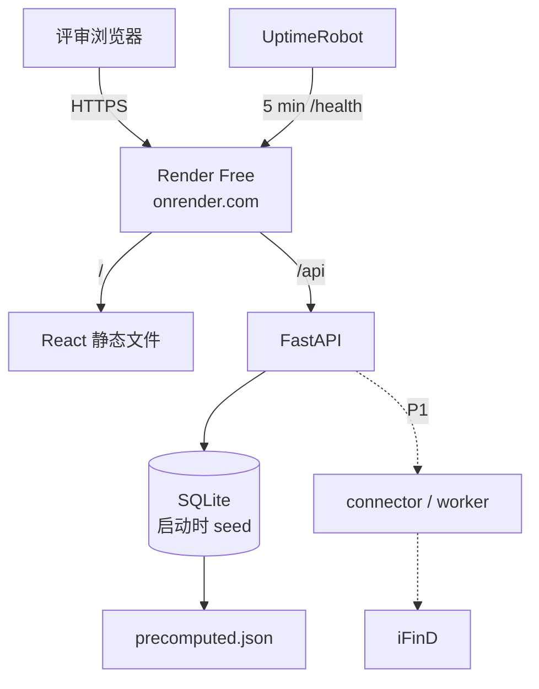

# 事证 EventProof · 零成本部署方案

> 约束：没有服务器、没有域名、不购买任何付费资源。目标仍然是给评审一个可访问、可操作的公网 URL。

## 1. 结论

采用 **Render Free Web Service + SQLite 启动 seed + UptimeRobot Free**（Neon 可选）：

| 组件 | 免费方案 | 作用 | 主要限制 | 应对 |
| --- | --- | --- | --- | --- |
| Web / API | Render Free Web Service（Docker） | 一个容器同时托管 React 静态文件和 FastAPI | 750 小时/月；15 分钟无请求休眠；唤醒约 1 分钟；512MB 内存 | 只部署一个服务；UptimeRobot 每 5 分钟 ping `/health`；重任务离线预计算 |
| 数据库 | SQLite 文件（启动时从 `precomputed.json` 重建） | 事件、claim、证据、版本、通知 | Render 免费实例文件系统是临时的，重启会恢复种子 | 单用户只读 demo 足够；多用户持久化再接 Neon |
| 保活 | UptimeRobot Free | 每 5 分钟访问 `/health`，避免 Render 休眠 | 50 个监控、5 分钟间隔 | 只监控一个 URL；`/health` 不触发 DB |
| AI | `AI_MODE=precomputed` | 离线生成 claim/摘要/裁决，部署只读结果 | 不能在线改 prompt 立即生效 | 保留 prompt/model 版本；需要时本地重跑并重新部署 |
| 域名 | 不需要 | 使用 `https://<app>.onrender.com` | 不能自定义域名 | 评审直接用平台子域名；HTTPS 自动提供 |

**总成本：0 元。** 免费额度可能调整，注册时以控制台为准。

## 2. 架构



关键取舍：

- **单服务**：React build 和 FastAPI 放在同一个 Docker 镜像里，FastAPI 挂载静态文件。没有 CORS，没有第二个免费服务占用额度。
- **SQLite 启动 seed**：Render 免费实例没有持久磁盘，所以容器启动时从 `fixtures/tongyu/precomputed.json` 重建 SQLite；重启会恢复种子，适合单用户只读 demo。
- **AI 预计算**：部署时不跑 LLM，避免 API 费用和冷启动延迟；页面仍展示 AI 产物、引用校验和模型版本。
- **保活不碰数据库**：`/health` 只返回进程状态；`/health/db` 才检查 SQLite。

## 3. 为什么不用其它零成本方案

| 方案 | 为什么不作为主方案 | 适用场景 |
| --- | --- | --- |
| Vercel Hobby | 函数有执行时长限制，长任务/worker 不适合；Python 依赖打包也更麻烦 | 只托管静态前端 |
| Hugging Face Spaces | 国内访问不稳定；免费空间磁盘非持久；Docker 可用但账号/网络摩擦大 | Render 注册受阻时的备选 |
| Cloudflare Tunnel 快速隧道 | URL 每次重启会变；必须保持本机开机；评审过几天再点可能已失效 | 演示当天的备用入口 |
| 香港 VPS + 域名 | 需要付费；域名还要备案/解析 | 有预算时的正式方案 |
| Supabase Free | 可用，但免费项目长期不活跃会暂停；Neon 的 Postgres 连接更直接 | Neon 的替代 |

## 4. 部署步骤

### 4.1 准备账号与仓库

1. GitHub 建仓库（public 或 private 均可；public 的 Actions 分钟数更宽松）。
2. 注册 [Render](https://render.com)（免费，不需要主动购买）。
3. 注册 [UptimeRobot](https://uptimerobot.com)（免费）。

Neon 不是当前 demo 的必需项；只有需要多用户持久化写操作时再注册。

如果 Render 注册时要求绑卡验证，而你不希望绑卡：改用 Koyeb Free 或 Hugging Face Spaces，Docker 镜像和 `render.yaml` 的 env 结构基本可复用；不要为了部署临时购买服务器。

### 4.2 SQLite seed

不需要单独建数据库：

- `fixtures/tongyu/precomputed.json` 随镜像一起部署；
- 应用启动时 `init_db()` 在空文件上建表并灌入 4 份文档、15 条 claim、4 个 revision；
- `data/eventproof.db` 在容器内生成；Render 重启/重新部署会回到种子状态；
- 当前唯一持久写操作是“通知已读”；重启后恢复未读，这是 demo 可接受的边界。

如果后续要做多用户、持久化告警规则或人工审核，再接 Neon/Postgres；当前代码没有 Postgres adapter，不要假装已经支持。

### 4.3 Render

1. New → Web Service → 连接 GitHub 仓库。
2. Runtime 选 Docker；Plan 选 Free；Region 优先 Singapore（如有）。
3. Health Check Path 填 `/health`。
4. 环境变量：

```env
AI_MODE=precomputed
DATA_MODE=fixture
DEMO_MODE=true
ADMIN_TOKEN=<随机生成的管理员 token>
PUBLIC_BASE_URL=https://<app>.onrender.com
TZ=Asia/Shanghai
```

5. 启动时应用自动建表并从 `precomputed.json` 灌入种子。Render 免费实例没有 Shell，也不支持一次性 Job，所以不要依赖手工迁移。
6. 记录 Render 分配的 `https://<app>.onrender.com`，不需要买域名。

Render 免费实例可能在任意时刻重启，文件系统是临时的；SQLite 只作为 demo 的只读快照，不作为持久化数据库。

### 4.4 UptimeRobot

1. 新建 HTTP(s) monitor。
2. URL：`https://<app>.onrender.com/health`。
3. 间隔：5 分钟。
4. 告警邮箱填自己的。

这样 Render 不会因为 15 分钟无请求而休眠；单服务 24/7 约 730 小时/月，通常落在 750 小时免费额度内。若 Render 调整额度，改为 10 分钟 ping 或接受约 1 分钟冷启动。

注意：Render 文档明确说，免费实例若产生异常高的**服务发起外网流量**（例如频繁访问外部 API）可能被暂停。因此定时抓取默认关闭，iFinD 只在管理员手动刷新时调用，页面读取走本地 SQLite 快照。

### 4.5 验证

```bash
curl -sS https://<app>.onrender.com/health
curl -sS https://<app>.onrender.com/api/events | head
```

再用 Playwright 跑一遍：收件箱 → 事件详情 → 证据抽屉 → 否认/更正 → 通知 → as-of 回放 → 导出。

### 4.6 演示写操作

公开评审需要“能操作”，但当前切片的写操作很克制：

- 可操作：事件筛选、as-of 回放、证据抽屉、版本 diff、简报切换、通知已读、证据包导出。
- 当前写接口只有“通知已读”和 `POST /api/demo/reset`；还没有模拟否认/更正/合并审核的运行时写接口。
- reset 需要 `X-Admin-Token`；公开页面不暴露 token。
- iFinD 实时刷新未开放到前端，避免公开流量消耗账号配额。

## 5. 零成本 AI 模式

默认 `AI_MODE=precomputed`：

- 已用阿里云百炼 `qwen3.8-flash` 跑完 4 份文档，输出写入 `fixtures/tongyu/precomputed.json`。
- 记录包含 `model`、`prompt_version`、`input_hash`、`quote`、tokens、cost；当前 15 条 claim、¥0.0072。
- 部署时只读这些结果；不把模型 key 放进 Render。
- 页面标注“AI 辅助整理”，每条 claim 仍可点回原文。

可选 `AI_MODE=free_api`：

- 设计上只在管理员手动触发“重新抽取”时调用，不在页面加载时调用；当前切片未实现运行时调用。
- 每日请求/token 上限、内容 hash 缓存、失败降级到规则。

`AI_MODE=rules`：

- 完全不依赖模型；规则抽取标题/数字/否认/更正，同一性用实体 + 时间 + trigram。
- 作为接口不可用、额度耗尽、评审环境无外网时的兜底；当前切片未实现完整规则抽取。

## 6. 运维与安全

| 事项 | 做法 |
| --- | --- |
| 冷启动 | Render 约 1 分钟唤醒；UptimeRobot 保活；前端显示“正在唤醒服务”；关键页面可先用静态快照渲染 |
| SQLite 重置 | 容器重启会从 `precomputed.json` 重建；通知已读状态会恢复；演示前调 reset 即可 |
| 密钥 | 只放 `ADMIN_TOKEN`；模型 key 不部署；iFinD token 只在本机预计算/验证时使用 |
| 公开访问 | 演示只读；管理员 reset 需 `ADMIN_TOKEN`；写操作仅通知已读/reset，限流待补 |
| 数据许可 | 公开演示优先公开权威材料；iFinD 只展示必要摘录与派生结论，不全文转载 |
| 备份 | `precomputed.json` + `sources.json` 是种子源；不需要 pg_dump |
| 回滚 | Render 按 commit 重新部署；SQLite 自动重建 |
| 额度 | 只建一个 Web Service；不建常驻 worker；定时抓取默认关闭，演示用管理员按钮 |

## 7. 风险与备用入口

| 风险 | 影响 | 备用方案 |
| --- | --- | --- |
| Render 冷启动/休眠 | 首屏约 1 分钟 | UptimeRobot；加载页；视频备份 |
| 国内访问慢/不稳定 | 评审打不开 | 演示当天开 Cloudflare Tunnel 作为备用 URL；README 同时放视频和证据包 |
| SQLite 临时文件 | 重启后通知已读/reset 状态丢失 | 启动自动重建种子；demo 可接受；持久化再接 Postgres |
| Render 要求绑卡 | 无法注册 | Koyeb Free / Hugging Face Spaces；Docker 镜像不变 |
| 免费政策变化 | 额度不够 | 保持单服务、预计算、静态快照；不把免费额度当 SLA |

**给评审的说明**：主 URL 是 `https://<app>.onrender.com`；如果当天访问慢，README 里提供 Cloudflare Tunnel 备用入口和 60–180 秒演示视频。免费层的冷启动是已知边界，不作为产品能力的一部分。

## 8. 成本表

| 项目 | 费用 | 说明 |
| --- | --- | --- |
| 服务器 | ¥0 | Render Free Web Service |
| 域名 | ¥0 | 使用 `onrender.com` 子域名 |
| 数据库 | ¥0 | SQLite 启动 seed；Neon 仅在需要持久化时可选 |
| 保活 | ¥0 | UptimeRobot Free |
| CI/CD | ¥0 | GitHub Actions 免费额度 |
| LLM | ¥0 | 预计算；不调用付费 API |
| iFinD | 按现有账号额度 | 已安装 SKILL；产品侧用服务端 token |
| 合计 | **¥0** | 不含你自己已有的网络和电脑 |
